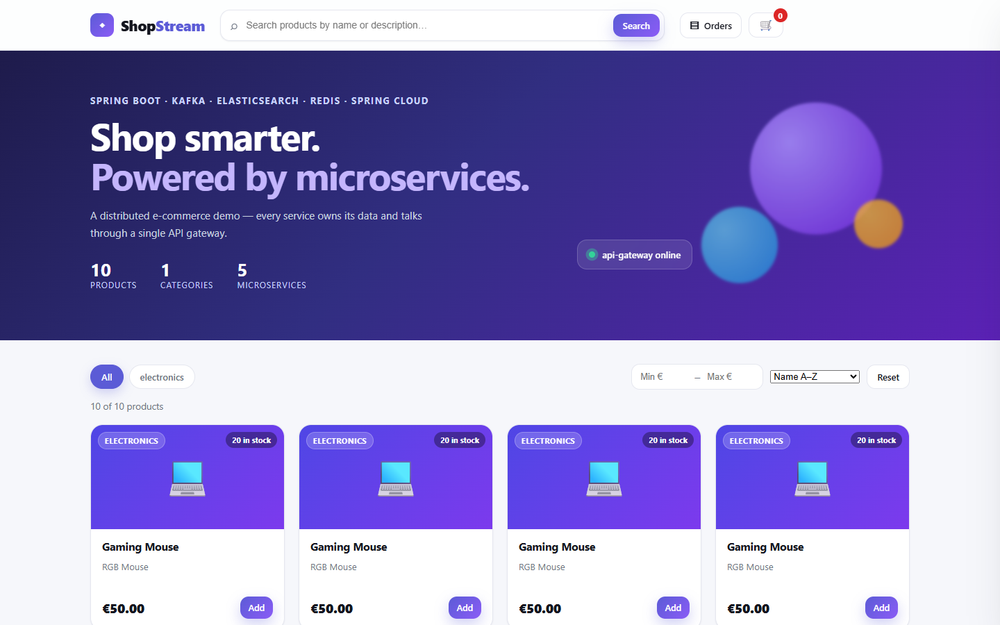

# ShopStream

A distributed e-commerce platform built with Spring Boot microservices and a React storefront.



## Architecture

```
                     ┌──────────────────────┐
   Browser ─────────▶│  frontend (nginx)    │ :3000
                     │  React + Vite bundle │
                     └──────────┬───────────┘
                                │ /api/*  (same origin, no CORS)
                     ┌──────────▼───────────┐
                     │  api-gateway         │ :8080
                     └──────────┬───────────┘
                                │ Eureka service discovery
        ┌───────────────┬───────┴────────┬────────────────┐
        ▼               ▼                ▼                ▼
 product-service   order-service   search-service   cart-service   notification-service
   :8081             :8082            :8084           :8083            :8085
      │                 │                │               │                  │
  product-mysql     order-mysql     Elasticsearch      Redis           (logs only)
      │                 │                ▲
      └───── Kafka product-events ───────┘
                        │
                 Kafka order-events ──▶ product-service (reserve stock)
                        ▲                      │
                        └──── Kafka inventory-events ────▶ notification-service
```

- **discovery-server** (:8761) — Eureka registry.
- **config-server** (:8888) — serves configuration from `config-repo/`.
- **api-gateway** (:8080) — single entry point, routes `/api/**` and load-balances via Eureka.
- **frontend** (:3000) — React SPA served by nginx; proxies `/api/` to the gateway.

## Quick start

```bash
docker compose up -d --build
```

| What | URL |
| --- | --- |
| Storefront | <http://localhost:3000> |
| API gateway | <http://localhost:8080> |
| Eureka dashboard | <http://localhost:8761> |
| Elasticsearch | <http://localhost:9200> |

The catalog starts empty on a fresh database — click **Load demo products** on the storefront.

## Backend services

| Service | Responsibility | Storage |
| --- | --- | --- |
| product-service | Product CRUD, Redis read cache, publishes `product-events`, reserves stock from `order-events` (idempotent) | MySQL `productdb` |
| order-service | Creates orders, prices items via Feign, publishes `order-events`, confirms/rejects from `inventory-events` | MySQL `orderdb` |
| search-service | Full-text search and filters over products | Elasticsearch |
| cart-service | Cart REST API (`@RedisHash` + `@TimeToLive`), checkout via Feign to order-service | Redis |
| notification-service | Consumes `order-events` and `inventory-events`, logs one email per final order status | — (logs only) |
| api-gateway | Routing + request-id filter | — |

### Order flow

```
POST /api/orders → PENDING → order-events
  → product-service reserves stock → inventory-events
    → order-service sets CONFIRMED / REJECTED → order-events
      → notification-service logs the email
```

Stock reservation is idempotent: the `processed_orders` table stores every handled `orderId`,
so a duplicated `OrderPlaced` message cannot reduce stock twice. Stock is decremented with a
single `UPDATE ... WHERE stock >= quantity`, so two instances cannot oversell.

### Cart lifetime

Carts are stored in Redis with `@RedisHash("carts")`, keyed by `userId`, and expire after
**1 hour** (`@TimeToLive`, `Cart.CART_TTL_SECONDS = 3600`).

## Frontend features

- Product catalog with category chips, price range, sorting.
- Full-text search through `search-service`, with a **local fallback** when the
  Elasticsearch index has not caught up yet (Kafka is asynchronous).
- Product detail modal, live stock information.
- Client-side cart persisted in `localStorage`.
- Checkout through `POST /api/orders`.
- Order tracking through `GET /api/orders/{id}`, with recent orders remembered locally.
- Toast notifications, empty/error states, responsive layout.

## API used by the frontend

| Method | Path | Purpose |
| --- | --- | --- |
| GET | `/api/products` | List products |
| GET | `/api/products/{id}` | Product detail |
| POST | `/api/products` | Create product |
| PUT / DELETE | `/api/products/{id}` | Update / delete product |
| GET | `/api/search` | Search: `text`, `category`, `minPrice`, `maxPrice`, `page`, `size` |
| POST | `/api/orders` | Create order: `{ "items": [{ "productId": 1, "quantity": 2 }] }` |
| GET | `/api/orders/{id}` | Order status and items |
| GET | `/api/carts/{userId}` | Read the cart |
| POST | `/api/carts/{userId}/items` | Add an item: `{ "productId": 1, "quantity": 2 }` |
| PUT | `/api/carts/{userId}/items/{productId}` | Change quantity: `{ "quantity": 3 }` |
| DELETE | `/api/carts/{userId}/items/{productId}` | Remove an item |
| DELETE | `/api/carts/{userId}` | Empty the cart |
| POST | `/api/carts/{userId}/checkout` | Send the cart to order-service; cart cleared only on success |

## Development

Backend:

```bash
docker compose up -d
```

Frontend dev server (hot reload, proxies `/api` to `localhost:8080`):

```bash
cd frontend
npm install
npm run dev          # http://localhost:5173
```

Production build:

```bash
cd frontend
npm run build        # outputs dist/
```

## Documentation

- [Demo script for the oral exam (Chinese)](docs/demo-script.md)
- [Frontend notes (defense preparation, Chinese)](docs/frontend-notes.md)
- [Frontend README](frontend/README.md)
- [Postman collection](docs/postman/ShopStream.postman_collection.json)

## Known limitations

- The storefront still keeps the cart in `localStorage`; the cart API in the gateway
  (`/api/carts/**`) works and can be used with Postman, but the React page has not been switched
  over to it yet.
- The search index is rebuilt from Kafka events; products created before search-service
  started may not appear in Elasticsearch until they are updated.
- notification-service logs emails to stdout — there is no real mail transport.
